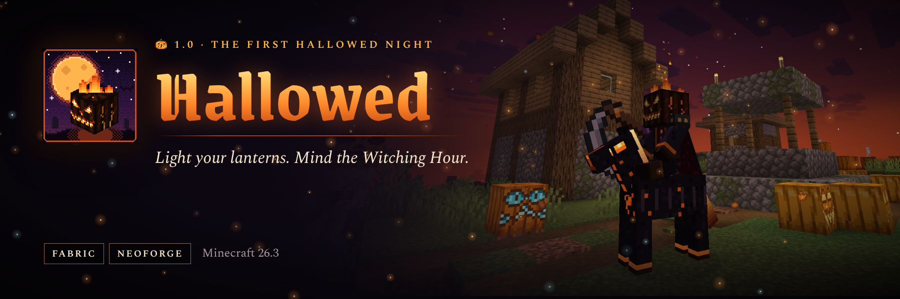

# Hallowed



Halloween, done properly. From October 15 to November 5 every night is a **Hallowed Night**: a violet sky and a
swollen Harvest Moon, villagers who answer the door with candy or a trick, spirits that drift out of the dark and
will-o'-the-wisps that lead to buried treasure. At midnight the bell strikes twelve, and if a Cursed Pumpkin has
been left out, the **Hollow Horseman** rides. Mod id: `hallowed`.

## Features

- **Hallowed Nights** in season, and on one full moon in four the rest of the year. A dusk banner, a violet sky and
  fog, a Harvest Moon, drifting embers and leaves, and ambient owls, wind, chimes and whispers.
- **The Witching Hour**: twelve tolls of a bell at midnight, a banner, and until 3 AM twice the spirits.
- **Trick-or-treating**: hold a Treat Pail out to a villager. Treats go into the pail, costumes earn more, and six
  harmless tricks keep you guessing. Costumed zombies and skeletons roam the night.
- **Eight candies** with real effects, from stacking **Sugar Rush** (and the Sugar Crash after it) to Ghost Gummies,
  Witch's Lollipops and Soul Toffee.
- **Carved faces**: shears carve eight faces into any pumpkin, a torch lights it, a soul torch gives it a blue flame.
  Every face can be worn.
- **Lantern ward**: lit jack o'lanterns (vanilla ones too) keep spirits away within 12 blocks, soul ones 20.
- **Spirits** that swoop through walls and leave you Spooked, and **will-o'-the-wisps** that lead you to a
  **Hallowed Cache**, or into a cursed ambush with a richer one.
- **The Hollow Horseman**, a two-phase boss on a burning nightmare steed: scythe sweeps, flaming jack o'lanterns,
  charges you can stun against a wall, then on foot with his spirits and his own thrown head. He drops the
  **Reaper Scythe** (Reap harvests and replants crops around you) or the **Horseman's Head**, a music disc and more.
- An original waltz on a music disc, 14 advancements, `/hallowed` commands and two commented JSON configs with
  `/hallowed reload`.

## Requirements

| Workspace | Minecraft | Loaders | Java |
| --- | --- | --- | --- |
| `26.3/` | 26.3 | Fabric, NeoForge | 25 |

Fabric needs Fabric API. Install the mod on both the server and the client: the server runs the nights, spawns and
the boss, and the client draws the sky, banners and effects.

## Documentation

- [docs/USAGE.md](docs/USAGE.md): how every system works, every recipe, config key and command
- [PATCH_NOTES.md](PATCH_NOTES.md) and [patchnotes/1.0.0.md](patchnotes/1.0.0.md): what changed
- [marketing/](marketing/): CurseForge and Modrinth page, summary, artwork and screenshots

## Building

```bash
cd 26.3 && ./gradlew build   # Java 25
```

Jars land in `26.3/<loader>/build/libs/hallowed-<loader>-26.3-<version>.jar`. Release builds are copied to
[`releases/`](releases/).

## Tools

- `python3 tools/assets/build.py 26.3` regenerates every texture, model, blockstate, sound, the music disc,
  language file, recipe, loot table, tag and advancement from code. Add `--no-sounds` to keep the audio as it is
  (synthesising the music takes a while).
- `tools/assets/preview.py` has the contact-sheet helper used to review generated art at a glance.
- `tools/qa/prepare_runs.sh 26.3 <loader> tools/qa/options.txt`, then `tools/qa/devrun.sh start-server 26.3 <loader>` and
  `tools/qa/devrun.sh start-client 26.3 <loader>` run a dev server and client (RCON on 25575) under Xvfb for in-game
  checks; `tools/qa/client.py` drives them.
- `python3 marketing/source/capture.py` and `node marketing/source/render.cjs` retake the screenshots and rebuild
  the listing artwork. See [marketing/README.md](marketing/README.md).

## Contributing

See [CONTRIBUTING.md](CONTRIBUTING.md) and [CODE_OF_CONDUCT.md](CODE_OF_CONDUCT.md).

## Security

See [.github/SECURITY.md](.github/SECURITY.md).

## License

Licensed under the [Apache License 2.0](LICENSE). See [NOTICE](NOTICE).
